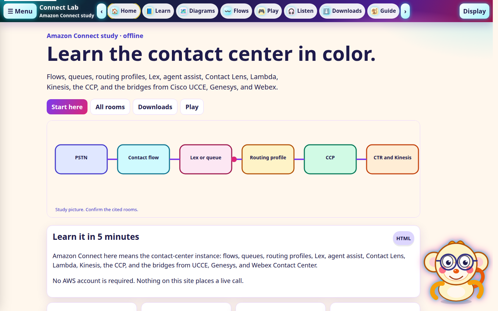
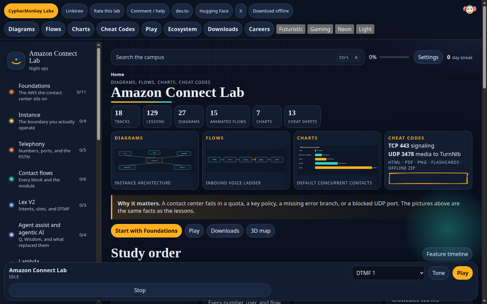
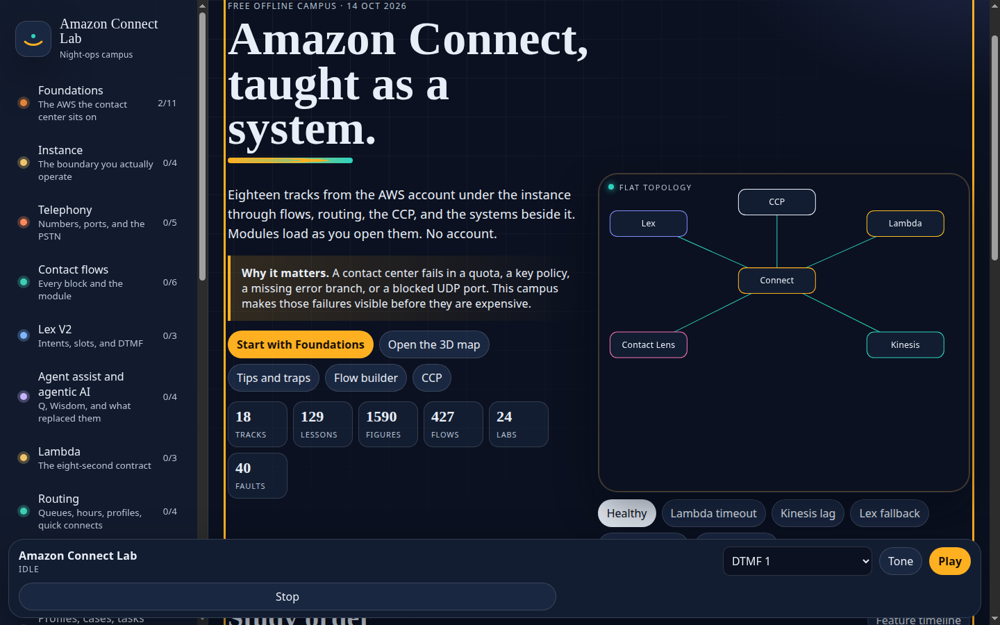
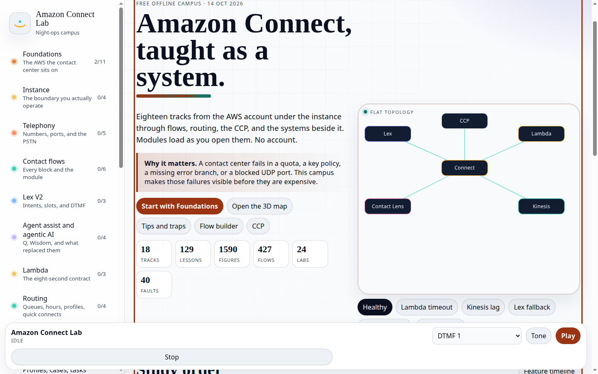
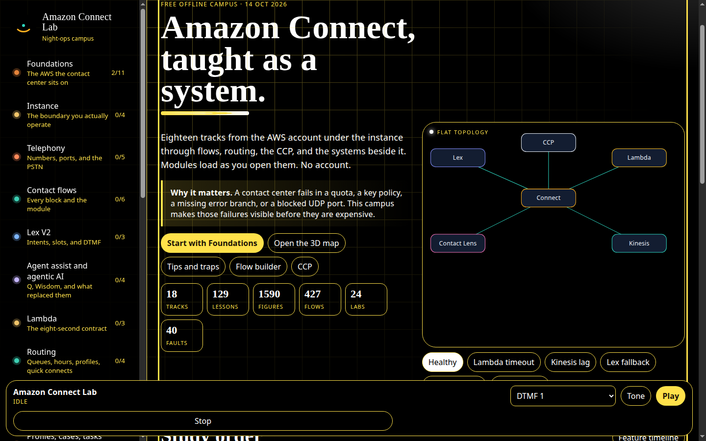
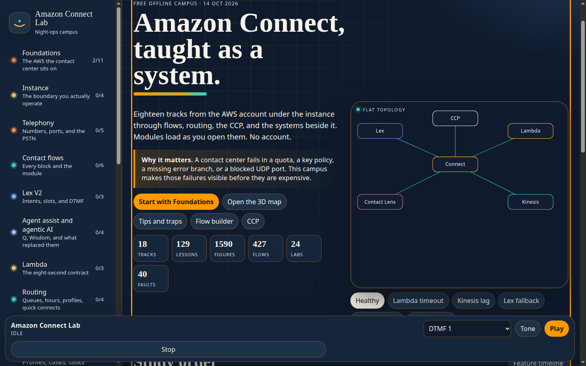

# Amazon Connect Lab



The study site is the repository root. It is a static lab for Amazon Connect flows, queues, routing profiles, Lex, agent assist, Contact Lens, Lambda, Kinesis, the CCP, and the bridges from Cisco UCCE, Genesys, and Webex. It does not call AWS. It does not claim that anyone has run Amazon Connect in production.

```bash
python3 scripts/build_site.py
node scripts/gzip-static.mjs
```

Open `http://127.0.0.1:8742/`. `file://` will not load the guide module. GitHub Pages can publish this branch from `/`. `.nojekyll` is at the root.

The older campus shell remains under `campus/` for the previous build. The pages you should read are `index.html`, `rooms/`, `tracks/`, and `downloads/`.



Night ops, light, futuristic, gaming, neon, high contrast, and the console theme:






Free offline campus for Amazon Connect: 18 tracks, 129 lessons, 24 browser labs, 1,590 illustrations, and 427 animated flows. One entry page. No CDN. No AWS account.

**Topics:** `amazon-connect` `aws` `contact-center` `telephony` `education` `offline` `interactive-learning` `github-pages`

Serve the `campus` folder over HTTP. `file://` cannot load the modules.

```bash
python3 scripts/build_campus.py
python3 -m http.server 43123 --directory campus
```

Then open `http://127.0.0.1:43123/`. The repository root `index.html` redirects to `campus/`. GitHub Pages should publish the `campus` directory (`.nojekyll` is already there). After the first visit, the service worker caches the shell and fills the rest of the curriculum in the background, so a later visit works offline.

## What changed from the single-file build

| | Before | After |
| --- | --- | --- |
| Entry | The same 4,906,039-byte HTML copied at the repo root, `campus/index.html`, and `campus/amazon-connect-lab.html` | One shell, `campus/index.html` (about 6 KB). Curriculum is per-track JSON fetched on demand. |
| First load | ~4.9 MB parsed up front | The shell stays small. Three.js r170 loads with the home hero (`hero.js`) and again on the 3D map |
| DOM | ~592 nodes, the whole campus mounted at once | One view at a time, measured under 400 nodes on home, lessons, labs, and studios |
| Heading | No `h1` | One `h1` per view |
| 3D | A single 2D canvas | The home view starts a full-bleed Three.js hero behind the chrome (ring, orbiting nodes, particles, neon grid, vendored UnrealBloomPass) with no click. `#/map` still loads the orbit-controlled architecture scene, and its node colours follow the theme. Reduced motion or a missing WebGL context keeps a flat fallback |
| Mobile | One 980px breakpoint | Phone header stays within 64px. A full-screen menu and a Learn / Diagrams / Play / Menu / Listen bar sit under 640px. The track drawer remains under 980px |
| Lighthouse 12.8.2, mobile, headless Chrome 154 | Not scored on the single-file page. An earlier pass that parsed Three.js on the home page scored performance 84 with 590 ms total blocking time | The score of performance 99 was measured before this hero. It is not a current claim for the WebGL home page |

A later route check in the same browser stayed on one `h1` and under 400 nodes: home 359, a foundations lesson 321, the flow builder 308, Erlang 233, the CCP 240, Contact Lens 234, the 3D map 289. Python's `http.server` does not gzip. GitHub Pages does, so the text-compression warning in this local run is the server, not the campus.

## Studios and labs

Twenty-four labs still run in the browser, including the contact-flow builder, call path, routing designer, Lambda invoke, CTR inspector, Erlang C calculator, pricing estimator (14 October 2026 Oregon DID rates), IAM checker, and fault finder.

Connect-specific studios:

- **Flow builder** imports and exports Amazon Connect flow-language JSON, version `2019-10-30`, and checks actions against the public flow-language reference.
- **3D map** (`#/map`) orbits the instance topology and toggles Lambda, Kinesis, Lex, turn, and Contact Lens failures.
- **CCP softphone** (`#/ccp`) rings with a local 440 Hz + 480 Hz tone, answers, tracks talk time and sentiment, and saves a wrap-up. It does not open a WebRTC peer.
- **Contact Lens playback** (`#/lens`) scrubs a scripted transcript, category tags, and card-number redaction.
- **Erlang C** plots live wait probability and service level as agents and shrinkage change.
- **CDK / CloudFormation** sits on a tab in every lesson, one snippet set per track.

## Settings and tips

Settings (`#/settings`) store the theme, sound effects, narration, reduced motion, type size, and interface language in `localStorage` under `acl-campus-v1`, with the streak and quiz progress. Themes include Neon, Holographic, Cyberpunk, Sunset, Light, Night ops, Futuristic, Gaming, High contrast, and Console. The default is Neon. A Dark / Light control toggles Light against the last colourful theme. Interface labels and lesson headings switch among English, Spanish, Hindi, Telugu, French, German, Japanese, and Arabic (Arabic is right-to-left). The first lesson of each track is translated into those languages. Every other lesson body stays in English, and the page says so. Narration waits for `voiceschanged`, prefers a natural or high-quality voice, and does not select Microsoft Edge unless you pick that voice. Speed runs from 0.6× to 1.6×.

Tablet and desktop keep the campus menu on screen: Diagrams, Flows, Charts, Cheat Codes, Play, Ecosystem, Downloads, Careers, and Settings. A phone uses one header (logo and Menu) and a full-screen sheet for those sections, language, and theme, plus a bottom bar for Learn, Diagrams, Play, Menu, and Listen. The home page opens on a full-bleed Three.js call-path hero (UnrealBloomPass from the vendored r170 examples), a large inbound hop row (TCP 443 and UDP 3478), an animated mascot, and two short architect clips in `audio/`. Those clips are espeak-ng stand-ins; the player stays wired for a later recording at the same paths. The Diagram Atlas is `data/atlas.json` (27 diagrams, 15 of them animated, 7 charts). Each diagram also has a portrait stack so a phone can read it without sideways scrolling. Diagrams and flows are one per row and open in a lightbox with play, pause, and step. Every track page shows a chart, a counter, and a live WebGL icon. Anime.js, Rough.js, D3, and canvas-confetti are vendored.

Cheat codes (`#/cheats` and `#/downloads`) are one-page HTML, PDF, and PNG sheets for ports, call flows, cutover, the firewall matrix, careers, and the 2026 timeline, plus `downloads/flashcards.json` and `downloads/amazon-connect-lab.zip`. The studio bar, the phone menu, and the footer use the same five brand buttons: Visit my GitHub, Visit the Labs org, Visit Cypher Monkey Labs, X, and Hugging Face. Each campus menu item is an icon, a label, and one line, with a search field and a 44px tap target. A phone keeps a bottom bar. Guide Bot is a scripted chat on `guide-kb.json`: it cites a page in this lab, or it says it does not know. The footer links the contact form for work and for a takedown. No email address is shown. The next-lab strip uses `https://cyphermonkeylabs.com/<repo>/`. Gemini Gems stays on `https://cipher0x9.github.io/gemini-gems-free-gallery/`.

Tips (`#/tips`) is one cheat sheet per track: pro tips, interview traps, and a short table. The same sheet is the Tips tab on every lesson. Counts match the single-file campus on `main` with a delta of zero: 1,590 illustrations, 427 animated flows, 25 audio clips, 24 labs, 927 quiz items, and 927 cards.

Progress, theme, and streak stay in `localStorage` under `acl-campus-v1`.

## What is inside

Eighteen tracks and 129 lessons, from the AWS services Connect sits on through the ecosystem around it.

- Foundations: IAM, Regions, Lambda, S3, Kinesis, CloudWatch, networking, certifications, and a dated feature timeline.
- Instance, telephony, contact flows, Lex V2, agent assist, Lambda, routing, the CCP, profiles, cases, tasks, channels, analytics, security, quotas, pricing, and Global Resiliency.
- Troubleshooting, with one-fault drills.
- Bridge: CUCM, UCCX, UCCE, Webex Contact Center, Genesys, and Avaya.
- Integrations: Salesforce, ServiceNow, Microsoft Teams, and a PBX kept beside Connect.
- Ecosystem: glossary, mind map, native and third-party WFM, recording and quality, conversational analytics, US E911 for CCP agents, CRM faults, AI configuration, integration maps, and future hooks.

Shared campus tokens (`--cc-bg`, `--cc-surface`, `--cc-accent-1` through `--cc-accent-4`) are the night-ops palette: ink on `#0b1120`, amber, mint, indigo, and rose. Day shift, high contrast, and the console orange-on-navy theme use the same tokens.

## Rebuild

```bash
python3 scripts/build_campus.py
python3 scripts/og_card.py
python3 scripts/verify_campus.py
```

`verify_campus.py` checks the track, lesson, lab, quiz, card, scenario, glossary, illustration, animated-flow, chart, audio, and fault floors. It requires every lesson to carry figures, an animated flow, a Try it lab, and an IaC tab. It rejects duplicate artwork, external scripts, and a second `h1`. It also round-trips a sample flow and the official flow-language example.

`releases/amazon-connect-lab.zip` is the `campus` folder (about 921 KB compressed). Unzip it and serve that directory. Do not open `index.html` as a file URL.

## Sources

Each lesson ends with the page the facts came from. The Sources view lists them. Prices are list prices from the public appendix as read for this campus on 14 October 2026. They are estimates, not invoices. Voice ID support ended on 20 May 2026. The admin guide renamed several features on 4 August 2026: Contact Lens is conversational analytics, Amazon Q in Connect is agent assist, and Voice+ is Live Sync. The AWS Certification catalog has no Amazon Connect specialty exam. Connect-specific recognition on Skill Builder is a badge, passed at 80 percent.

Three.js r170, its OrbitControls example, and the UnrealBloomPass composer (EffectComposer, RenderPass, UnrealBloomPass, CopyShader, LuminosityHighPassShader) are vendored under `web/vendor` and `campus/vendor` under the MIT license. See `NOTICE.md`.

## License

Code and original study text are released under the MIT license. AWS names, marks, and documentation remain with Amazon Web Services.
