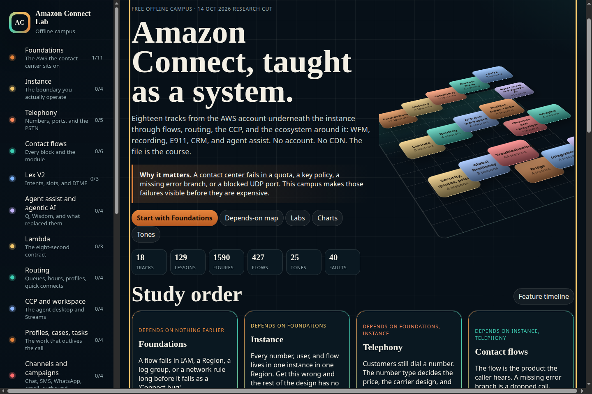

# Amazon Connect Lab



Free offline campus for Amazon Connect: 18 tracks, 129 lessons, 24 browser labs, 1,590 illustrations, and 427 animated flows. One HTML file. No CDN. No AWS account.

**Topics:** `amazon-connect` `aws` `contact-center` `telephony` `education` `offline` `interactive-learning` `github-pages`

Open `campus/index.html` in a browser, or serve the `campus` folder:

Open `campus/index.html` in a browser, or serve the `campus` folder:

```bash
python3 scripts/build_campus.py
python3 -m http.server 43123 --directory campus
```

Then open `http://127.0.0.1:43123/`.

The same file is at the repository root as `amazon-connect-lab.html`. `releases/amazon-connect-lab.zip` is the packaged copy plus the social card.

## What is inside

Eighteen tracks and 129 lessons, starting with the AWS services Connect sits on and ending with the ecosystem around it. The file also holds 1,590 distinct illustrations, 427 animated flows, 23 charts, 25 synthesized tones, and a 40-fault catalog.

- Foundations: IAM, Regions, Lambda, S3, Kinesis, CloudWatch, networking, certifications, and a dated feature timeline.
- Instance, telephony, contact flows, Lex V2, agent assist, Lambda, routing, the CCP, profiles, cases, tasks, channels, analytics, security, quotas, pricing, and Global Resiliency.
- Troubleshooting, with one-fault drills.
- Bridge: CUCM, UCCX, UCCE, Webex Contact Center, Genesys, and Avaya.
- Integrations: Salesforce, ServiceNow, Microsoft Teams, and a PBX kept beside Connect.
- Ecosystem: glossary, mind map, native and third-party WFM, recording and quality, conversational analytics, US E911 for CCP agents, CRM faults, AI configuration, integration maps, and future hooks.

Twenty-four labs run in the browser. They include a contact-flow builder, a call-path simulator, a routing-profile designer, a Lambda invoke simulator, a CTR inspector, an Erlang C calculator, a pricing estimator dated 14 October 2026, an IAM checker, a WebRTC explainer, a fault finder, and a platform translator.

Progress, the theme, and the streak are stored in `localStorage` under `acl-campus-v1`.

## Rebuild

```bash
python3 scripts/build_campus.py
python3 scripts/og_card.py
python3 scripts/verify_campus.py
```

`verify_campus.py` checks the track, lesson, lab, quiz, card, scenario, glossary, illustration, animated-flow, chart, audio, and fault counts. It requires every lesson to carry three figures, an animated flow, and a Try it lab. It rejects duplicate artwork, external scripts, stylesheets, and common CDNs.

## Sources

Each lesson ends with the page the facts came from. The Sources view lists them. Prices are list prices from the public appendix as read for this campus on 14 October 2026. They are estimates, not invoices. Voice ID support ended on 20 May 2026. The admin guide renamed several features on 4 August 2026: Contact Lens is conversational analytics, Amazon Q in Connect is agent assist, and Voice+ is Live Sync. The AWS Certification catalog has no Amazon Connect specialty exam. Connect-specific recognition on Skill Builder is a badge, passed at 80 percent.

## License

Code and original study text are released under the MIT license. AWS names, marks, and documentation remain with Amazon Web Services.
